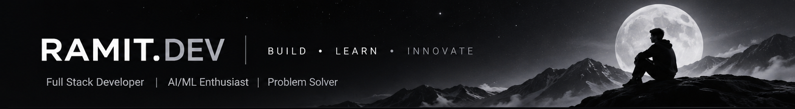

# Hey, I'm Ramit 👋

**Computer Science Undergraduate · Full-Stack Developer · AI/ML Enthusiast**

I build practical software across the frontend, backend, and data layers — and enjoy understanding the engineering decisions behind it.

---

## About

- 🎓 Computer Science undergraduate, focused on AI/ML.
- 🧩 Interested in full-stack product development, backend engineering, databases, and applied AI.
- 🛠️ Currently strengthening my skills in system design, data structures, and building reliable applications.
- 🌱 I value clear code, thoughtful architecture, testing, and useful documentation.

## Tech stack

  

## Selected projects

### [Smothered64](https://github.com/ramitl25727-cyber/Smothered64)
A TypeScript monorepo for a web-based chess application, backend services, and a reusable chess engine package.

**Technologies:** TypeScript, Next.js, React, Node.js, pnpm, PostgreSQL, Prisma

### [DE_Project_2026](https://github.com/ExplorInfinity/DE_Project_2026)
A team data-engineering project involving PostgreSQL data loading, SQL query design, indexing, and benchmark-based query optimization.

**Technologies:** PostgreSQL, SQL, indexing, query plans, benchmarking

### [SNW-Capstone-Project](https://github.com/ramitl25727-cyber/SNW-Capstone-Project)
A capstone project repository. See the repository README for its current scope, implementation, and technologies.

---

## GitHub activity

## Contribution graph

  

## Contribution Snake

  

## Connect

- GitHub: [@ramitl25727-cyber](https://github.com/ramitl25727-cyber)
- LinkedIn: add your profile URL here when ready
- Portfolio: coming soon

---

  Build · Learn · Innovate · Repeat

